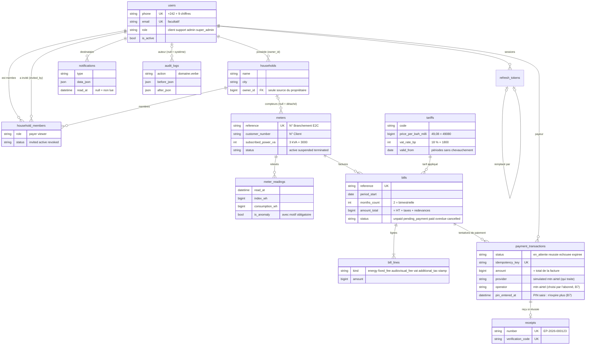

# Schéma de la base ElecPay (B1)

13 tables, MySQL 8.4, créées par 6 migrations Alembic (`backend/alembic/versions/`).
Conventions : `id` BIGINT auto-incrémenté ; `created_at` / `updated_at` en UTC (microsecondes) ;
montants en FCFA entiers ; énergie en Wh entiers ; prix en millièmes de FCFA ; taux en points de base.
Calculs de facture : voir [`FACTURE_E2C.md`](FACTURE_E2C.md).

## Relations

## Garde-fous assurés par la base

Ces règles tiennent même si un futur code est bogué ou si quelqu'un écrit du SQL à la main.

| Règle métier | Mécanisme |
|---|---|
| Rien n'est jamais supprimé en cascade | toutes les clés étrangères en `RESTRICT` |
| Montants et énergie entiers, jamais négatifs | type `StrictBigInteger` (refuse les float) + `CHECK >= 0` |
| Valeurs fixes (rôles, statuts, types) | `VARCHAR` + `CHECK ... IN (...)` |
| Un tarif : périodes sans chevauchement | triggers `trg_tariffs_no_overlap_*` |
| Facture jamais supprimée, contenu jamais modifié, figée une fois payée ou annulée | triggers `trg_bills_*`, `trg_bill_lines_*` |
| Une seule facture active par compteur et par période | colonne calculée `active_period_start` + unicité |
| Une seule transaction en attente, une seule réussie par facture | colonnes calculées `pending_bill_id` / `succeeded_bill_id` + unicité |
| Montant payé = total de la facture ; facture payée ou annulée non payable | trigger `trg_payment_transactions_insert` |
| Transaction terminée figée (aucun admin ne peut forcer un succès) ; opérateur, numéro, montant fixés à la création ; « PIN saisi » jamais effacé (B7) | trigger `trg_payment_transactions_update` |
| Reçu seulement pour un paiement réussi, jamais modifié (sauf ajout du PDF) | triggers `trg_receipts_*` |
| Journal d'audit jamais modifié ni supprimé | triggers `trg_audit_logs_*` |

Les triggers exigent l'option MySQL `log_bin_trust_function_creators=1`
(activée dans `docker-compose.yml` et dans la CI).

## Règles vérifiées par les services (pas exprimables en contraintes simples)

- le propriétaire d'un foyer n'est pas aussi membre de son propre foyer (B4) ;
- seul un payeur délégué actif ou le propriétaire peut payer les factures d'un foyer (B7) ;
- l'index d'un nouveau relevé ne descend pas sous le précédent, sinon relevé marqué en anomalie (B2 / B5) ;
- total d'une facture = somme de ses lignes (B2 / B6, testé) ;
- aucun mot de passe, jeton ou hash dans les journaux d'audit (B10 / B11).
