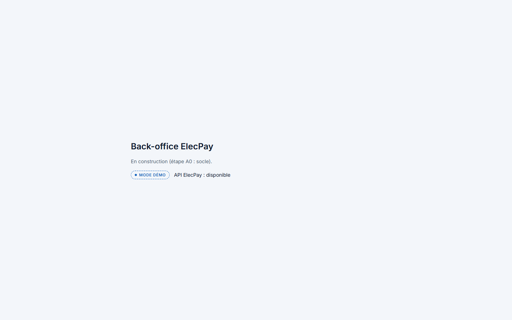

# Rapport de fin d'étape A0 — Socle du back-office (27/11/2026)

**A0 est terminée** : tout est dans `main` (dernier commit `e9b6dd6`), CI `Admin` verte à chaque
sous-étape. En attente du « Continue » de Loick avant A1 (connexion et double authentification).

## Ce qui est fait

| Sous-étape | Contenu |
|---|---|
| A0.1 | Projet Next.js 16.4.6 dans `frontend/admin/` (App Router, React 19.3, TypeScript 5.9 strict, Tailwind 4.3), npm et Node 24, versions exactes. Contrôles : ESLint (règles Next + accessibilité `jsx-a11y` strictes, jamais de HTML injecté), Prettier, Vitest + Testing Library. CI `.github/workflows/admin.yml`. |
| A0.2 | Thème **généré depuis `frontend/design/tokens.json`** (Jour par défaut, Nuit pour le menu ; seules les valeurs de la charte dans Tailwind), test de fraîcheur. **Formats** portés du mobile à l'identique (montants FCFA entiers, kWh, dates de Brazzaville, périodes bimestrielles, téléphones ; mêmes cas de test). **Statuts** (couleur + icône + mot) testés contre `openapi.json`. Aucun caractère invisible écrit en dur. |
| A0.3 | **Relais `/api/v1/*`** : préfixes ouverts seulement (`health`, `auth/web`, `auth/password`, `me`, `admin`), requêtes qui modifient acceptées seulement depuis le back-office, en-têtes sur liste blanche (cookies `elecpay_*` seulement, aucune IP), `ngrok-skip-browser-warning`, API injoignable / trop lente / page d'erreur de ngrok → message clair avec une référence, journal sans donnée sensible. |
| A0.4 | **Types générés depuis `backend/openapi.json`** (test de fraîcheur), client typé, jeton anti-CSRF recopié à chaque requête qui modifie, erreurs de l'API (message + référence), lectures TanStack Query (30 s, aucune interrogation périodique, aucune relance : DA2.3). |
| A0.5 | **CSP à nonce** neuf par page + en-têtes fixes (HSTS, nosniff, no-referrer, noindex…) ; contrôles en CI : en-têtes sur le vrai serveur de production, **rien de sensible dans le code envoyé au navigateur**, `npm audit`. **Badge « Mode démo »** lu dans `GET /health` à travers le relais. MSW pour tous les tests (une requête non prévue fait échouer le test). |

**Critère « Terminé quand » vérifié** :
- dans un vrai navigateur (l'Edge du PC piloté par Playwright), en production (`next start`) **et**
  en développement (`npm run dev`) : page au thème de la charte, badge « Mode démo » arrivé de
  `/health` à travers le relais, **console sans erreur** (la CSP stricte ne bloque rien) ;
- en-têtes présents sur les pages et sur le relais ;
- CI `admin.yml` verte, lancée seulement pour `frontend/admin/**`, `tokens.json`, `openapi.json` et
  le workflow lui-même (DA0.8).

**Essai réel du relais** sur une API de test (port 8011, base jetable `elecpay_e2e`, jamais l'API
publique ni la base de démo) : santé et mode démo, route du client refusée (404), connexion sans
`Origin` refusée (403), connexion avec `Origin` transmise à l'API, tentative de sortie (`..`) refusée,
**session complète par cookies** (connexion du compte support, cookies `HttpOnly` / `Secure` /
`SameSite=strict` posés sur le domaine du back-office avec leurs chemins, profil, déconnexion
refusée sans jeton anti-CSRF puis acceptée avec).

## Choix faits en route, et leur raison

- **« Cache Components » désactivé** : la CSP à nonce exige que chaque page soit rendue à la
  requête, alors que Cache Components prérend une coque statique ; le back-office ne met rien en
  cache côté serveur (tout est lu dans le navigateur). **À revoir pour Next 17**, où l'option est
  annoncée comme obligatoire.
- **TypeScript 5.9.3** (celui du modèle officiel de Next 16), pas la 7.0 qui vient de sortir.
- **jsdom 29** : les versions 30 et 31 exigent Node ≥ 24.15 (le PC a 24.14).
- Jeton `current` de la charte → `current-base` dans Tailwind (`current` y désigne déjà la couleur du
  texte).
- Ombres en `--ep-shadow-*` (et non `--shadow-*`, nom réservé par Tailwind) ; tous les autres noms de
  variables sont ceux de `frontend/design/tokens.css` (vérifié par un test).
- CSP : `style-src-attr 'unsafe-inline'` (React écrit des attributs `style="…"`, qui ne peuvent pas
  exécuter de code) ; `upgrade-insecure-requests` seulement en HTTPS (sinon le serveur local de test,
  en HTTP, casserait).
- Relais : une page d'erreur de ngrok (tunnel fermé, PC éteint) ou une redirection devient un message
  clair, jamais relayée telle quelle.
- **Playwright pilote l'Edge du PC** (`channel: "msedge"`) pour le contrôle dans un navigateur :
  rien à télécharger. La mise en place complète (Chromium en CI, base `elecpay_admin_e2e`) reste
  en A1.5.

## Défauts trouvés et corrigés

1. **Vitest chargé deux fois sous Windows** (« Vitest failed to find the current suite ») : cherché
   pas à pas à la demande de Loick. Cause : Node démarré dans `c:\…` (lettre de lecteur en minuscule,
   donnée par le shell de VS Code) → Vitest chargeait son propre module par `c:\…` et par `C:\…`.
   Reproduit à coup sûr, corrigé par `tool/vitest.ts` (casse officielle du dossier), utilisé par
   `npm test`. Mon premier diagnostic (« l'`expect` global de Vitest 5 est différent ») était faux :
   vérifié puis corrigé dans le code et le journal.
2. **MSW 3 ignorait sans erreur l'option `onUnhandledRequest`** (renommée `onUnhandledFrame`) : la
   garde « aucun test ne touche le réseau réel » ne fonctionnait pas. Trouvé par le contrôle des
   types, corrigé, prouvé par `tests/no-network.test.ts` (contre-épreuve : il échoue si la garde est
   coupée).
3. Contrôle du code du navigateur : signalait le mot `NEXT_PUBLIC_` écrit dans un commentaire ; une
   variable exige maintenant un nom après le préfixe (cas ajouté aux tests).
4. Test de fraîcheur des types : dépassait le délai de 5 s sur le PC chargé (génération : 12 s) ;
   délai explicite de 60 s, comparaison inchangée.
5. Test de mon propre relais : apostrophe typographique dans un en-tête HTTP (interdit par le
   protocole) ; donnée du test corrigée.

## Commits (branche `a0`, tous intégrés dans `main`)

`6cb640b` A0.1 · `dcc144f` A0.2 · `b8c62ac` A0.3 · `7553ce8` A0.4 · `e6409a7` sauvegarde (après la
coupure) · `e9b6dd6` A0.5 · plus ce rapport et les tableaux de bord.

## Tests

**176 tests, tous réussis** (16 fichiers) ; bout en bout : aucun encore (A1.5).
- Unitaires : formats (84), relais (45), erreurs et client (15), en-têtes (8), statuts (5), lectures (1).
- Composants : état de l'API et badge (5), page (1).
- Contrôles : fraîcheur du thème (5) et des types (2), code du navigateur (3), caractères invisibles (1),
  garde réseau (1).
- En CI en plus : en-têtes sur le serveur de production, code du navigateur, `npm audit`.

## Nouvelles dépendances (versions exactes)

- Application : `next` 16.4.6, `react` / `react-dom` 19.3.0 (décidés) ; `@tanstack/react-query`
  5.108.4 (décidé) ; `openapi-fetch` 0.17.0 (client typé, DA « choix techniques ») ; `lucide-react`
  1.81.0 (icônes de la charte).
- Outils : `typescript` 5.9.3, `tailwindcss` + `@tailwindcss/turbopack` 4.3.3, `eslint` 9.39.5 +
  `eslint-config-next` 16.4.6 + `eslint-plugin-jsx-a11y` 6.10.2 (accessibilité stricte), `prettier`
  3.10.1 + `prettier-plugin-tailwindcss` 0.8.1, `vitest` 5.1.2 + `@vitejs/plugin-react` + `jsdom`
  29.0.2 + Testing Library, `msw` 3.0.8 (API simulée), `openapi-typescript` 7.13.0 (types du contrat),
  `@playwright/test` 1.65.1 (navigateur), types de Node et de React.
- Pas encore installés (arrivent avec leurs écrans) : shadcn/ui, TanStack Table, React Hook Form,
  Zod, Recharts.

## Ce que Loick doit regarder dans son navigateur

1. Depuis `frontend/admin` : `npm ci` puis `npm run dev`, et ouvrir http://localhost:3000.
   **Attention** : sans `ELECPAY_API_URL`, le relais vise l'API du port 8000. Si l'API publique
   tourne, c'est elle (base `elecpay_public`) ; pour A0 seule `/health` est lue, sans risque.
2. La page provisoire : fond clair de la charte, police Inter, badge **MODE DÉMO** en pointillés
   bleus, « API ElecPay : disponible ». API arrêtée : le message « L'API ElecPay ne répond pas… »
   avec sa référence, et « Réessayer ».
3. (Facultatif) Outils de développement → Réseau : la page n'appelle que `localhost:3000`, jamais
   l'API directement ; en-tête `content-security-policy` avec un nonce différent à chaque
   rechargement.

## Points à surveiller

- **Cible du relais en développement** : par défaut `http://127.0.0.1:8000`, donc l'API publique
  quand elle tourne. Dès A1 (connexions, actions), il faudra viser une API de démonstration locale
  ou de test, jamais l'API publique par accident. Je proposerai la règle au début de A1 (par exemple
  un port dédié au développement du back-office).
- Next 17 : Cache Components deviendra obligatoire, donc la CSP à nonce sera à revoir.
- Le défaut de casse du lecteur pourrait toucher d'autres outils lancés depuis le shell de VS Code
  (rien vu sur `next dev` ni `next build`).
- PC parfois très lent (une passe de tests a pris plus de 5 minutes, contre 30 secondes d'habitude).
- La coupure de courant du 27/11 a imposé un commit de sauvegarde (`e6409a7`) qui est entré dans
  l'historique de `main`, mais jamais en dernière position.

## Ce qui a été modifié ou supprimé en dehors de l'étape

- `CLAUDE.md` et `frontend/README.md` : tableaux de bord seulement.
- `.github/workflows/admin.yml` : nouveau (prévu au plan, A0.1 et A0.5).
- `frontend/admin/.gitkeep` supprimé (le dossier a maintenant du contenu).
- Rien dans `backend/` ni dans `frontend/design/` ; `frontend/mobile/` non touché.

## Tests modifiés ou supprimés, et pourquoi

- `src/app/page.test.tsx` : la page affiche maintenant l'état de l'API ; le test vérifie en plus le
  badge « Mode démo » (sur l'API simulée).
- `tool/api-types.test.ts` : délai explicite de 60 s (voir le défaut 4), comparaison inchangée.
- `src/lib/relay/relay.test.ts` : donnée d'un en-tête corrigée (défaut 5).
- Aucun test supprimé, aucun contrôle affaibli.
