# Rapport de fin d'étape A1 — Connexion, double authentification et session (28/11/2026)

**A1 est terminée** : tout est dans `main`, CI `Admin` verte à chaque sous-étape (dont le nouveau job
`e2e`). En attente du « Continue » de Loick avant A2 (cadre de l'application et composants communs).

## Ce qui est fait

| Sous-étape | Contenu |
|---|---|
| A1.0 | **Cible dédiée au développement** (ta demande avant A1) : `ELECPAY_API_URL` sans valeur par défaut ; manquante, ou vers le port 8000 (API publique, base `elecpay_public`), `next dev` et `next start` **refusent de démarrer** (prouvé par `tests/startup-guard.test.ts`, qui lance le vrai serveur). API de développement : `.\tool\dev-api.ps1` (port **8001**, base **`elecpay_admin_dev`**, écrits en dur, testé). « 1 Issue » de Next expliqué et corrigé (extension du navigateur). |
| A1.1 | **Connexion** : téléphone en saisie libre (« 06 123 45 67 »), mot de passe, client refusé, `429` → bouton à compte à rebours, erreurs avec leur référence ; étape du **code** (6 chiffres ou code de secours `ABCD-EFGH`, défi de 5 min affiché). |
| A1.2 | **Page « Sécurité »** : configuration de la double authentification, **obligatoire** pour admin et super admin (l'API répond `403 TWO_FACTOR_SETUP_REQUIRED` → page Sécurité, puis retour à la page demandée), recommandée pour le support ; QR code affiché comme image, clé à saisir à la main, premier code, **10 codes de secours montrés une seule fois** (copier, télécharger, « mis en lieu sûr » avant de continuer). |
| A1.3 | **Mot de passe oublié / première connexion** : téléphone → code reçu par SMS → nouveau mot de passe ; en mode démo, le code renvoyé par l'API est affiché (« aucun SMS envoyé »), comme sur le mobile. |
| A1.4 | **Session** : pages de l'équipe gardées (`/me` puis `/me/2fa`) ; **un seul rafraîchissement à la fois, aussi entre onglets** (DA1.3), requête rejouée avec le nouveau jeton anti-CSRF ; API injoignable ≠ session expirée ; fenêtre **« Session expirée »** puis retour à la page demandée (DA1.4) ; **déconnexion** de tous les onglets ; **déconnexion après 30 min sans activité**, avertissement 1 min avant (DA1.2) ; CSP stricte respectée en production. |
| A1.5 | **Mon compte** : profil (nom modifiable), mot de passe (toutes les sessions fermées → reconnexion), double authentification (état, nouveaux codes de secours, bandeau « recommandée » pour le support : DA1.5). **Tests de bout en bout** : Playwright, `tool/e2e.ps1` (base `elecpay_admin_e2e` recréée à chaque passage, API de test sur 8010 avec des jetons d'une minute, back-office construit sur 3010) et **job `e2e` de la CI** (DA0.9) : 11 parcours, axe sur chaque écran, aucune violation de la CSP ni erreur JavaScript tolérée. |

**Critère « Terminé quand » vérifié** (11 parcours de bout en bout, en local et dans la CI, sur l'API de
test) :
- les trois comptes de démo se connectent : support sans code, admin et super admin avec le code de
  leur application ; un client est refusé ; un mauvais mot de passe aussi ;
- la double authentification est exigée là où il faut : code demandé à l'admin et au super admin, pas
  au support (recommandée dans Mon compte) ; la configuration obligatoire (admin sans double
  authentification → page Sécurité) est couverte par les tests de composants et a été jouée sur l'API
  de développement ;
- la session expirée marche : rafraîchissement invisible quand le jeton d'accès d'une minute expire,
  fenêtre « Session expirée » quand la session est perdue, retour à la page après reconnexion ;
- la déconnexion marche : cookies effacés, autres onglets ramenés à la connexion ; après 30 min sans
  activité aussi.

### Captures (1440 px, serveur de production, API de test)

| | |
|---|---|
| 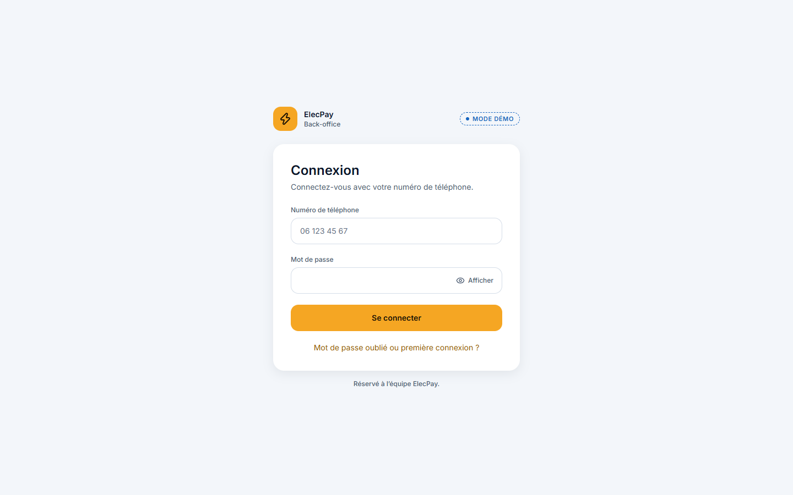 | 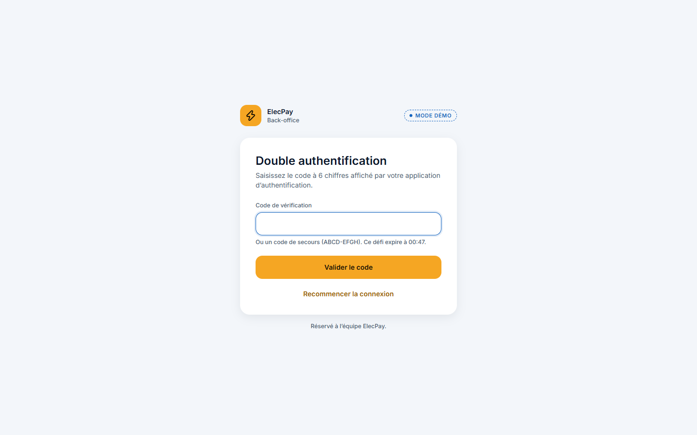 |
| Connexion (badge « Mode démo » lu dans `/health`) | Étape du code (6 chiffres ou code de secours) |
| 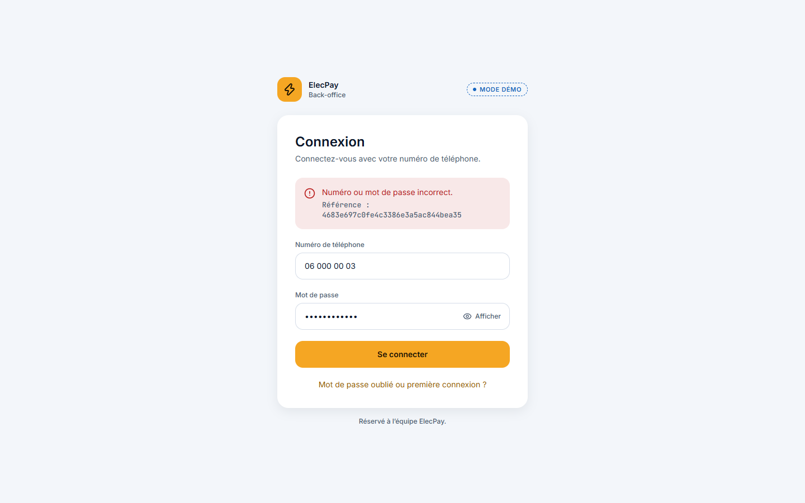 | 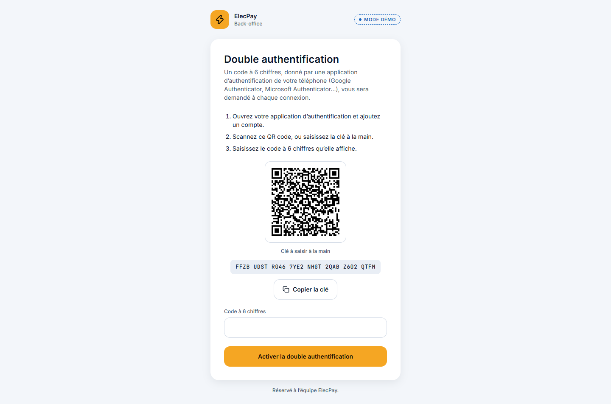 |
| Mauvais mot de passe : message et référence | Page Sécurité : QR code et clé |
| 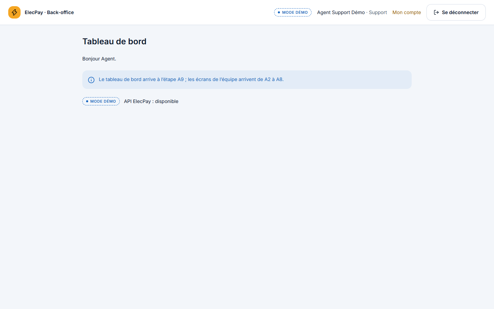 | 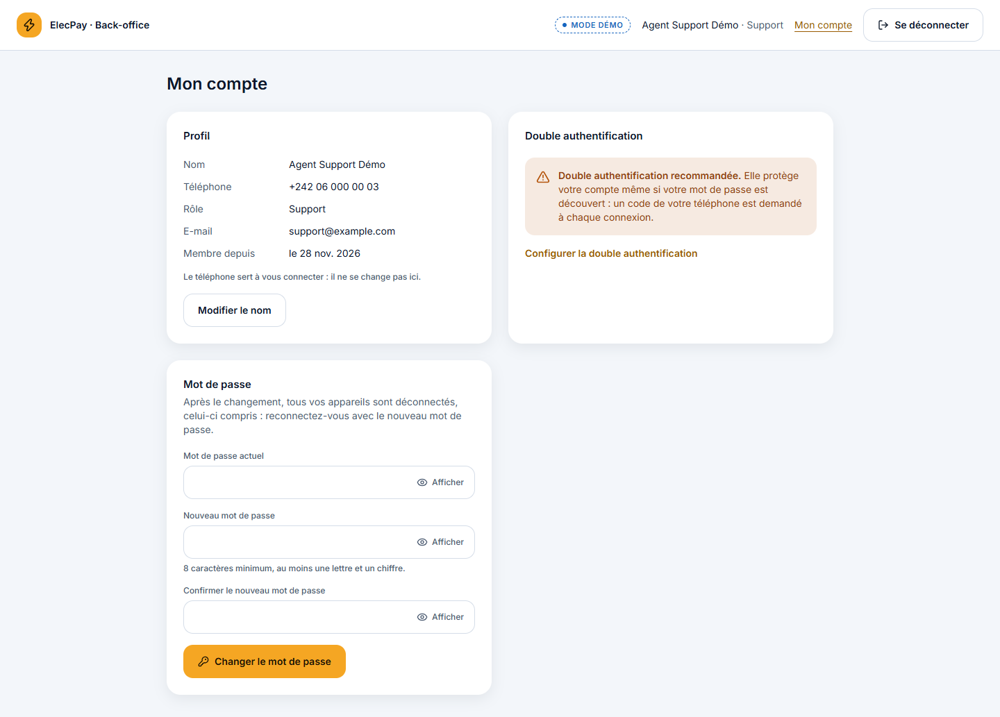 |
| Accueil provisoire (tableau de bord en A9) | Mon compte du support : double authentification recommandée |
| 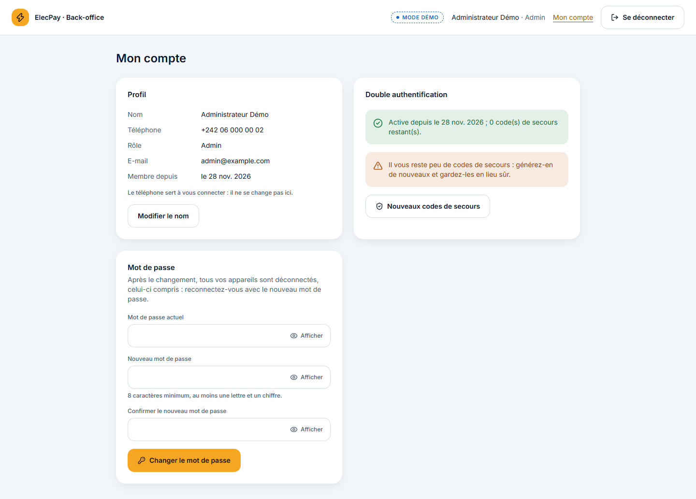 | 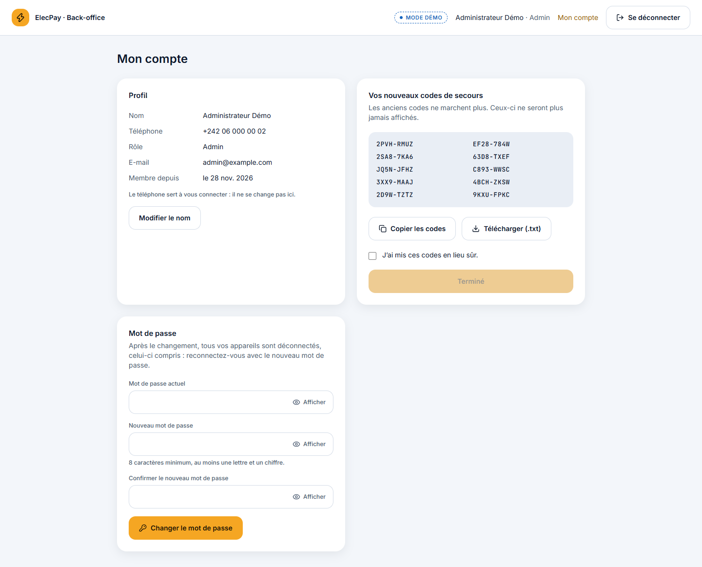 |
| Mon compte de l'admin : peu de codes de secours | Nouveaux codes, montrés une seule fois |
| 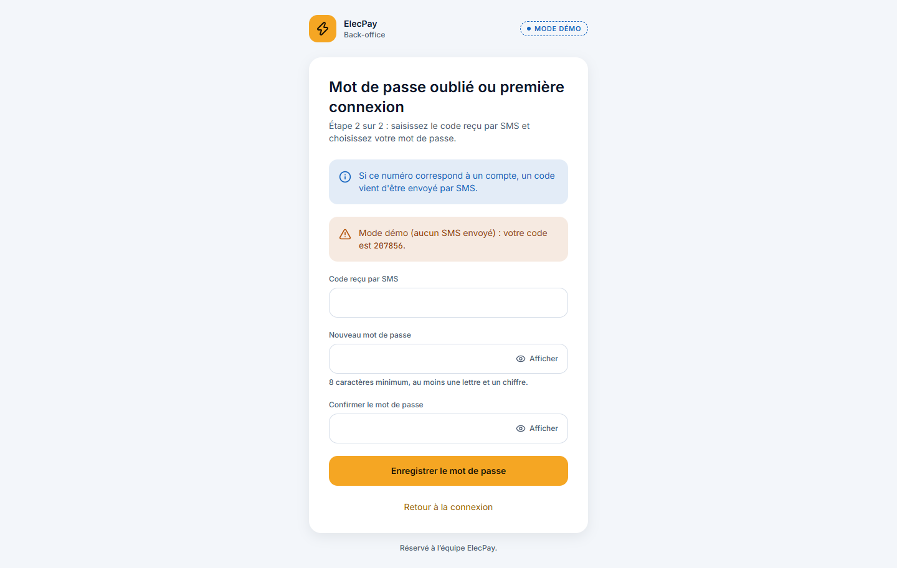 | 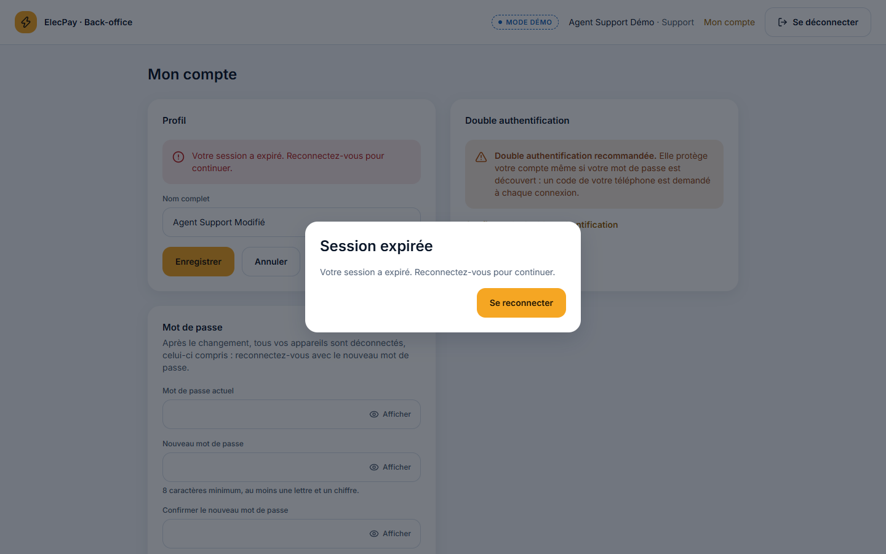 |
| Mot de passe oublié : code de démo affiché | Session perdue pendant le travail |
| 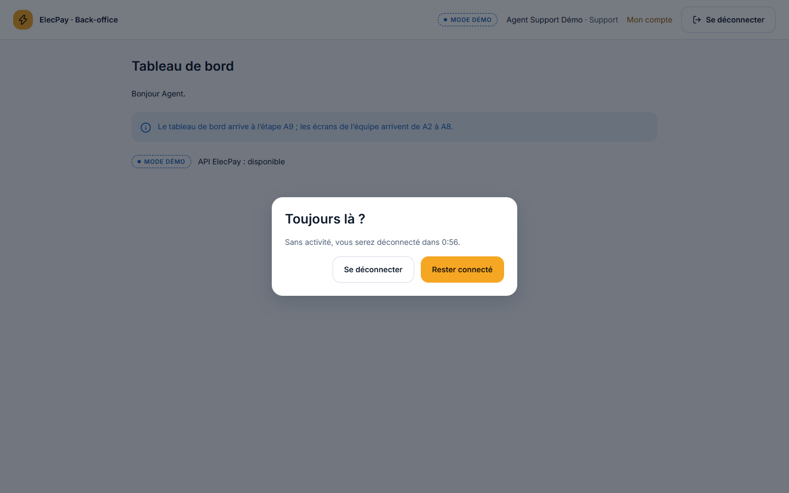 | |
| Après 29 min sans activité | |

Petits écrans (390 px) : [connexion](captures/A1-connexion-390.png) ·
[Mon compte](captures/A1-mon-compte-390.png). Les codes de secours visibles viennent de la base de
test, recréée à chaque passage : ils ne servent nulle part.

## Choix faits en route, et leur raison

- **Ports et bases** : 8000 = API publique (jamais) · 8001 = API de développement
  (`elecpay_admin_dev`) · 8010 = API des tests de bout en bout (`elecpay_admin_e2e`) · 3010 = back-office
  construit des tests. `next dev` et `next start` n'écoutent que `127.0.0.1`.
- **Seuls les 401 « de session » ferment la session** (jeton expiré, absent, illisible, réutilisé) ;
  la liste est vérifiée contre `backend/app/modules/auth/errors.py` par un test (lecture seule ; la CI
  se relance si ce fichier change). Un code de vérification faux reste une erreur ordinaire.
- **`POST /me/password` renvoie de nouveaux jetons dans son corps** (route pensée pour le mobile) : le
  back-office n'utilise que ses cookies `httpOnly`, donc **le relais retire ces jetons** (le code de la
  page ne les voit jamais ; test contre `openapi.json` : toute route ouverte qui renvoie des jetons doit
  être filtrée). Comme l'API ferme toutes les sessions, le back-office se déconnecte et la page de
  connexion explique pourquoi.
- **Mon compte** : le nom se modifie ; le téléphone non (c'est l'identifiant de connexion, à vérifier
  par SMS) ; l'e-mail est seulement affiché (il sert aux reçus des clients). « Désactiver la double
  authentification » (support) n'est pas proposé, puisqu'elle deviendra obligatoire pour le support
  après le MVP.
- **Nouveaux codes de secours** : avec le code de l'application seulement (l'API refuse un code de
  secours pour cette action).
- **CSP stricte en production** : Zod sans compilation de code, nonce transmis aux styles des fenêtres
  Radix, page « introuvable » de la charte (celle de Next écrivait un style sans nonce).
- **Alertes** posées sur une base blanche opaque (voir défaut 7).
- **Tests de bout en bout** : une session par test (réutiliser une session enregistrée présenterait un
  ancien jeton de rafraîchissement, ce qui révoque toute la session côté API) ; 16 tentatives de
  connexion par passage pour une limite de 20 par IP et par quart d'heure (garde-fou à 18) ; un code
  de double authentification neuf par connexion ; l'inactivité est jouée avec l'horloge de Playwright.
  En local, Playwright pilote l'**Edge du PC** (aucun navigateur téléchargé hors du dépôt) ; dans la
  CI, le Chromium de Playwright.
- **Patience des tests** : 5 s pour attendre un élément, 20 s par test (le PC chargé ralentissait
  parfois une réponse simulée au-delà de 1 s) ; ce que les tests vérifient ne change pas.

## Défauts trouvés et corrigés

1. **« 1 Issue » de Next** (ton signalement) : une extension du navigateur ajoutait un attribut à
   `<body>` ; reproduit en simulant l'extension, corrigé (`suppressHydrationWarning` sur `<html>` et
   `<body>` seulement).
2. **Edge affichait deux « œil »** dans le champ du mot de passe (le sien et le nôtre) : le sien est
   masqué.
3. **QR code non dessiné** : l'API produit un SVG sans `xmlns` (fait pour être collé dans une page) ;
   l'attribut est ajouté avant l'affichage comme image (vérifié dans Edge et dans les parcours).
4. **Compte à rebours trop long** après un `429` : il partait de l'ouverture de la page ; l'échéance et
   l'heure du refus sont maintenant enregistrées ensemble.
5. **Violations de la CSP sur le serveur de production** (vues dans la console) : Zod (`Function`),
   styles des fenêtres Radix, page 404 de Next ; plus un rafraîchissement inutile sans session (403).
   Corrigés et testés (contre-épreuves faites).
6. **Un code de vérification faux ouvrait « Session expirée »** (page Sécurité, nouveaux codes) :
   introduit par A1.4, trouvé en préparant A1.5, corrigé à part (`A1.4 (correctif)`), avec un test qui
   le reproduisait d'abord et le garde-fou sur `errors.py`.
7. **Contraste insuffisant (trouvé par axe en bout en bout)** : le bleu d'une alerte « information »
   posée sur le fond de page tombait à **4,49:1** (seuil : 4,5:1). Les alertes ont maintenant une base
   blanche opaque ; les contrastes des quatre tons sont calculés depuis les jetons, dans les deux
   thèmes (`alert-contrast.test.ts`, contre-épreuve comprise).
8. **« Authentification requise. »** s'affichait sous un formulaire, derrière la fenêtre « Session
   expirée » (vu sur une capture des parcours) : une session terminée affiche maintenant le texte de la
   fenêtre, sans référence technique.
9. Défauts de mes propres tests, corrigés : sélecteurs ambigus dans les parcours (l'annonceur de Next a
   aussi le rôle « alert » ; « Nouveau mot de passe » trouvait aussi « Confirmer le nouveau… ») ; espaces
   insécables comparés par Testing Library ; un test de contraste qui lisait deux fois le thème clair
   (une barre oblique perdue à l'écriture du fichier : corrigé, et un test vérifie maintenant le bon
   bloc de jetons).

## Commits (branche `a1`, tous intégrés dans `main`)

`6e0f9c9` A1.0 · `d06190f` A1.1 · `c81d3d7` A1.2 · `c11d9d9` A1.3 · `a717bac` A1.4 · `6266c99` A1.4
(correctif) · `44f25ee` A1.5 (1/2) · `215399c` A1.5 (2/2) · plus ce rapport et les tableaux de bord.

## Tests

**336 tests, tous réussis** (37 fichiers ; 176 à la fin de A0) et **11 parcours de bout en bout**
(4,6 min en local avec Edge ; 2,5 min dans la CI avec Chromium, job `e2e` de 4 min en tout).
- Unitaires : session (rafraîchissement unique, rejeu, classement des 401, inactivité, adresse de retour),
  règles de saisie (mêmes messages que le backend), compte à rebours, relais (dont le retrait des
  jetons), erreurs, nonce, Zod sans compilation.
- Composants : connexion et code, page Sécurité, mot de passe oublié, garde et fenêtres de session, Mon
  compte, page introuvable, accueil provisoire.
- Garde-fous : démarrage refusé sans `ELECPAY_API_URL` ou vers le port 8000 (vrai serveur lancé),
  scripts `dev-api.ps1` et `e2e.ps1` (bases et ports écrits en dur), configuration de Playwright (aucune
  autre base), 401 de session contre `errors.py`, routes à jetons contre `openapi.json`, contrastes des
  alertes depuis les jetons, caractères invisibles (y compris `e2e/`).
- Bout en bout : voir « Ce qui est fait » (A1.5) ; axe (WCAG 2.1 A et AA) : 13 contrôles (écrans, fenêtres, 1440 et 390 px),
  CSP et erreurs JavaScript surveillées sur chaque page.
- En CI en plus : construction, code du navigateur, en-têtes du serveur de production, `npm audit`, et
  le job `e2e`.

## Nouvelles dépendances (versions exactes)

- Application : `react-hook-form` 7.92.0, `zod` 4.6.7 et `@hookform/resolvers` 7.0.9 (formulaires,
  décidés) ; `radix-ui` 1.8.1 (fenêtres accessibles de shadcn/ui : « Session expirée »,
  inactivité) ; `class-variance-authority` 0.7.1, `clsx` 2.1.1, `tailwind-merge` 3.7.1 (variantes des
  composants, comme shadcn/ui) ; `get-nonce` 1.0.1 (nonce de la CSP pour les styles de Radix).
- Tests : `otpauth` 9.6.0 (codes de double authentification des parcours, depuis le secret de démo
  public), `@axe-core/playwright` 4.14.1 (accessibilité dans les parcours).

## Ce que Loick doit regarder dans son navigateur

1. Une fois : copier `frontend/admin/env.local.example` en `frontend/admin/.env.local` (s'il n'existe
   pas encore). Puis, depuis `frontend/admin`, dans un terminal : **`.\tool\dev-api.ps1 -Reset`** (base
   de développement neuve : voir « Points à surveiller ») ; dans un autre : `npm run dev`, et ouvrir
   http://localhost:3000.
2. **Support** `06 000 00 03` / `Demo2026!` : accueil provisoire ; « Mon compte » : bandeau
   « Double authentification recommandée ».
3. **Admin** `06 000 00 02` / `Demo2026!`, puis le code de ton application d'authentification (secret de
   démo `ELECPAYDEMO2FASECRETPOURLESTESTS`, à ajouter une fois) ; « Mon compte » → « Nouveaux codes de
   secours ».
4. **Session expirée** : outils de développement (F12) → Application → Cookies → supprimer
   `elecpay_access` et `elecpay_refresh`, puis « Modifier le nom » → « Enregistrer » : la fenêtre
   s'ouvre, « Se reconnecter » ramène à Mon compte après la connexion.
5. **Deux onglets** ouverts, « Se déconnecter » dans l'un : l'autre revient à la connexion.
6. « Mot de passe oublié ou première connexion ? » : le code de démo s'affiche.
7. (Facultatif) `.\tool\e2e.ps1` : les 11 parcours (environ 6 min, construction comprise).

## Points à surveiller

- **Session inutilisée après un changement de mot de passe** : l'API ouvre une session neuve pour
  l'appareil, dont les jetons sont retirés par le relais ; elle reste valable jusqu'à son expiration
  (30 jours) sans que personne ne puisse s'en servir. Sans risque, mais une variante web de la route
  (qui poserait les cookies) serait plus propre : **modification du backend**, à décider avec toi
  (arrêt avant `backend/`), pas nécessaire pour le MVP.
- **Base de développement** : un de mes essais de A1.2 a activé la double authentification du compte
  support de `elecpay_admin_dev` avec un secret inconnu ; `.\tool\dev-api.ps1 -Reset` remet les
  données de démo.
- **Budget de connexions des parcours** : 16 sur 20 par quart d'heure. Les parcours des étapes
  suivantes devront être regroupés (ou la limite revue avec la décision DA11.1).
- **PC très chargé** (Chrome, TradingView, Telegram, VS Code et ses extensions Java) : une suite
  complète a échoué une fois sur « Failed to start forks worker » ; relancée seule, elle passe.
- **Next 17** : Cache Components deviendra obligatoire, la CSP à nonce sera à revoir (déjà noté en A0).
- Le parcours « jeton d'une minute » attend 65 s : c'est voulu (vrai cookie expiré dans le navigateur).

## Ce qui a été modifié ou supprimé en dehors de l'étape

- `.github/workflows/admin.yml` : job `e2e` ajouté (prévu au plan, DA0.9) ; la CI se relance aussi
  quand `backend/app/modules/auth/errors.py` change (garde-fou des 401 de session).
- `CLAUDE.md` et `frontend/README.md` : tableaux de bord seulement.
- `PLAN.md` : port 8000 retiré de l'architecture (cible dédiée de A1.0).
- Rien de modifié dans `backend/` (deux fichiers seulement **lus** par des tests : `openapi.json` et
  `app/modules/auth/errors.py`) ni dans `frontend/design/` ; `frontend/mobile/` non touché.

## Tests modifiés ou supprimés, et pourquoi

- `src/app/page.test.tsx` → `src/app/(equipe)/page.test.tsx` (la page a rejoint le groupe des pages de
  l'équipe) : il passe maintenant par la garde de session.
- `src/features/security/two-factor-setup.test.tsx` : vérifie **en plus** qu'un code faux ne ferme pas
  la session.
- `src/lib/relay/relay.test.ts` (A1.0, ta décision) : deux cas de A0 **remplacés par des règles plus
  strictes** : « développement sans variable → API locale » devient « sans variable → refusé » ; « HTTP
  vers `localhost:8000` accepté » devient « port 8000 refusé partout ». Ajouts : retrait des jetons du
  corps des réponses.
- `tool/tokens.test.ts` : contrôle **en plus** le fichier de noms généré pour `tailwind-merge`.
- `vitest.setup.ts` / `vitest.config.mts` : plus de patience (5 s, 20 s), aucune assertion changée.
- `tests/source-characters.test.ts` : le dossier `e2e/` est contrôlé en plus.
- Aucun test supprimé, aucun contrôle affaibli.
